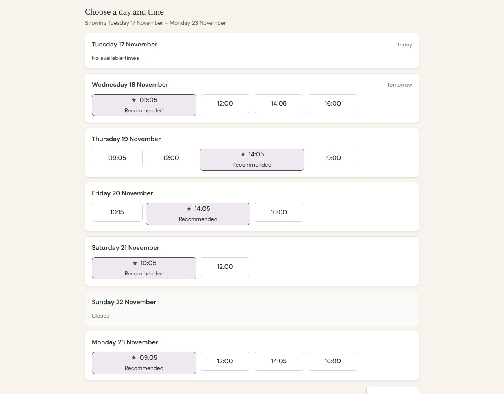
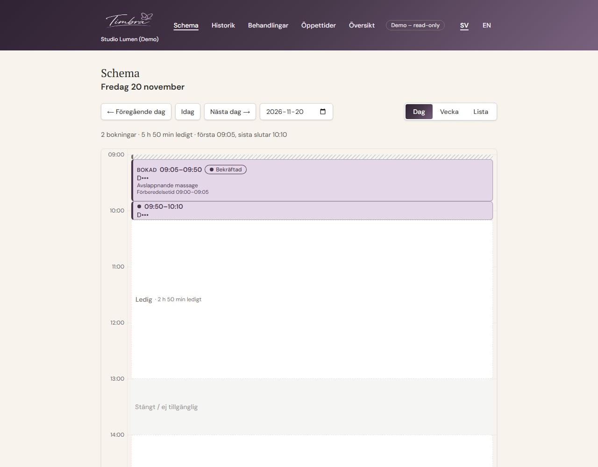

# Timbra — QA & Product Case Study

**Timbra is a salon booking platform developed in response to a salon owner's request. I defined its Magnetic Booking approach and led its AI-assisted development as a product and QA project.** It offers online customers only the times that keep the salon's calendar compact ("Magnetic Booking"), while the salon owner can still book any valid time.

**Status (17 November 2026):** a pilot for one salon. Release **v3.3.1** has been live in production since 17 November 2026, and the public demo runs the same release.
- **The interface:** a smoked plum and ivory design across the booking pages and the admin; a "Back to home" link on every booking step; an English option in the admin.
- **The booking-management page:** shows only the opened booking's own status, even when several management links are opened in the same tab.
- **Validation:** the salon owner has validated the booking algorithm (how times are offered and recommended); validation of the other features is still pending.
- **Not yet:** customers' terms, a privacy notice and live notifications are still being prepared for launch. Not a finished commercial product.

**▶ Demo (fictional data, release v3.3.1):** [Customer booking (Swedish)](https://timbra-booking-demo.vercel.app/sv/booking) · [Customer booking (English)](https://timbra-booking-demo.vercel.app/en/booking) · [Admin, read-only](https://timbra-booking-demo.vercel.app/admin)

### Try the demo

- **Don't enter real personal information.** The demo replaces whatever name, email and phone number you type with fictional details before saving, and it sends no email or SMS.
- **Customer booking** ([Swedish](https://timbra-booking-demo.vercel.app/sv/booking) · [English](https://timbra-booking-demo.vercel.app/en/booking)):
  - Pick one to five treatments; they run back to back, in the order you choose.
  - Then pick a date. You see only the offered times, in time order, with one marked as recommended. The time you choose is marked with a check mark.
  - "Back to home" ("Till startsidan") returns to the start page from any step.
  - Completing the form saves a booking in the shared demo. The demo accepts at most 20 public bookings an hour from all visitors together.
- **[Admin, read-only](https://timbra-booking-demo.vercel.app/admin)** (Swedish, with an English option):
  - Your booking appears in the day, week and list views, with the customer name masked (for example "D•••").
  - History, treatments, opening hours and an overview can be viewed too. Nothing can be changed.
- **Cancellation is switched off in the demo.** No management link is shown after booking, so a demo booking can't be cancelled and stays in the demo calendar. Outside the demo, customers cancel with their management link; that flow is covered by automated tests and by local tests with fictional bookings.

*Public demo, release v3.3.1, captured 17 November 2026 (desktop, English). On Friday 20 November, two existing demo bookings end at 10:10, so **10:15** is offered right after them, followed by the start and end of the remaining free time.*

*Read-only admin, release v3.3.1, captured 17 November 2026: confirmed bookings in muted lilac with a dark plum leading stripe and status symbol, the hatched 5-minute preparation strip, masked customer names, and the daily break. More screenshots, including V1, V2 and v2.1.0: [screenshot index](assets/screenshots/README.md).*

## My contribution

I'm **Adriana Bucur**, a QA / Software Tester. Timbra started with a salon owner's request for a better booking application. I developed the Magnetic Booking approach and defined the requirements and business rules with her input, and I own quality: QA strategy, risk analysis, test design, manual testing, validation and regression analysis.

**Product:**
- Turn the salon owner's feedback into requirements and business rules, for example offering only edge times (V2) and several treatments in one appointment (v3.0.0).
- Keep a prioritised backlog with acceptance criteria.
- Decide what is in each release and what is deferred.
- Approve visual and wording changes before they ship. The v3.3.0 design was reviewed and approved on preview builds before release.

**QA:**
- Risk-based test design (positive, negative, boundary, concurrency, time-zone and daylight-saving cases).
- Audits of the customer flow, for example the 24-hour cancellation cutoff checked at 25 h, 24 h and 23 h.
- Defect reproduction with fictional data, each fix guarded by a regression test.
- Contrast and keyboard checks on visual changes.
- Read-only verification of every release on the live sites.

**Releases:**
- Each release is a tagged candidate, checked again on its final commit (clean install, tests, types, lint, build).
- Each release is recorded with its exact deployed commit, and production is verified without creating bookings.

An AI coding assistant helps with the application code, the automated test code, documentation drafts and running checks. I direct the work, review what it produces, do the manual testing and make the product decisions. More in [My role & AI-assisted development](docs/about/my-role-and-ai-assisted-development.md).

This repository is documentation only; the application source code is private.

## Release history

| Version | Date | What changed |
|---|---|---|
| V1 | before 30 Sep 2026 | Every valid time bookable; the best one recommended |
| V2 | 30 Sep 2026 | **Magnetic Booking:** online customers see only a few edge times; the salon owner keeps every valid time |
| v2.1.0 | 6 Oct 2026 | Each day's earliest and latest start always offered; times in time order; daily 13:00–14:00 break; black/pink theme |
| v3.0.0 | 27 Oct 2026 | **Several treatments, one appointment** (up to five, back to back, one preparation) |
| v3.0.1 | 28 Oct 2026 | Clearer wording on the management page for appointments that have started or passed |
| v3.1.0 | 16 Nov 2026 | English option for the admin |
| v3.1.1 | 16 Nov 2026 | Short calendar cards no longer clip the status badge |
| v3.1.2 | 16 Nov 2026 | The running application version shown in the admin footer |
| v3.1.3 | 17 Nov 2026 | "Back to home" ("Till startsidan") on every booking step |
| v3.3.0 | 17 Nov 2026 | **Smoked plum and ivory redesign** with a diagonal plum gradient, contrast-checked; narrow week cards show a status symbol instead of a clipped label |
| v3.3.1 | 17 Nov 2026 | Each booking-management link shows only its own booking's status and messages |

There is no v3.2.0 release. `v3.2.0-rc.1` is a separate candidate (salon terms and admin support) still in review, outside the public demo.

## From V1 to V2 (history)

- **V1** ranked every valid time and recommended the best one, while customers could still pick any valid time.
- **Salon owner feedback (September 2026):** showing every free minute lets short treatments split long free periods into gaps that can't be sold. Free periods should fill from their edges inward.
- **V2 (production since 30 September 2026):** *technically available ≠ offered.* Online customers see only a few edge times; the salon owner keeps every valid time. On the same demo day, the public offer went from eight times plus "Show more" to two.
- **v2.1.0 (6 October 2026):** the day's earliest and latest start are always offered, times are listed in time order with the recommended one marked, and a daily 13:00–14:00 break was added.
- **v3.0.0 (27 October 2026): several treatments, one appointment.**
  - A customer picks up to five treatments in the order they want. Preparation happens once, before the first treatment; the treatments then run back to back.
  - Offered times are calculated for the combined length with the same rules.
  - On submit, the server re-reads the chosen treatments, their order and totals, and re-checks that the time is still offered.
  - The database then derives the stored totals itself, refuses unknown or changed treatments, and its overlap constraint rejects any booking that would collide with another.

Details, the before → after example and the verification: **[From V1 to V2](docs/product/evolution-v1-to-v2.md)**. How eligibility, the public offer and ranking work: **[Magnetic Booking](docs/product/magnetic-booking.md)**.

## QA evidence

| | |
|---|---|
| **Automated tests** | **Latest, v3.3.1 (17 November 2026):** 1,045 database-free tests passed on both the release candidate and the final commit: unit, domain logic and security guards. The 249 database-backed integration tests were not part of these runs. **Earlier:** 1,212 tests including real-database integration tests for v3.0.0 (27 October 2026), on an isolated, throwaway test database; 1,118 for v2.1.0 (6 October 2026); 654 unit and domain-logic tests on 29 September 2026 (first V2). Recorded results; not re-run for this page. |
| **Test design** | [33 selected test cases](docs/qa/test-cases/README.md) with positive, negative, boundary and concurrency cases, linked to a [risk register](docs/qa/risk-register.md) |
| **Defects and regressions** | [5 regression case studies](docs/qa/regression-case-studies.md): root cause, fix and the regression test that now guards it. Latest (v3.3.1, November 2026): after cancelling one booking, opening another booking's management link in the same tab showed the first booking's message. Reproduced with fictional bookings, fixed, and guarded by a regression test of that exact sequence. |
| **Manual testing** | Functional, visual and responsive checks of the customer and admin flows, in Swedish and English, desktop and mobile. For v3.3.0, a populated fictional calendar (short bookings, completed, no-show, blocked time) was checked at 320–1280 px, with every colour pair checked for WCAG AA contrast and keyboard focus checked with real Tab presses. |
| **Release practice** | Tagged release candidate → checks on the candidate → final commit that changes only the version → the same checks on that exact commit → production deploy → read-only checks of the live site (no booking created) → final tag and deployment record. Not verified by me: production admin views behind the salon owner's login. [Release v3.0.0 verification](docs/product/evolution-v1-to-v2.md#release-v300-27-october-2026) · [release v2.1.0 verification](docs/product/evolution-v1-to-v2.md#release-v210-6-october-2026) |

## Reading path (about 15 minutes)

1. [From V1 to V2](docs/product/evolution-v1-to-v2.md): feedback, decision, before → after, verification
2. [Magnetic Booking](docs/product/magnetic-booking.md): eligibility, the public offer and ranking
3. One complete QA chain: [traceability example 2](docs/qa/traceability-examples.md#example-2-the-admin-can-skip-minimum-notice-but-never-book-the-past) → [test case ADM-007](docs/qa/test-cases/booking-engine.md#adm-007-the-admin-still-cannot-book-a-past-time) → [regression case study 2](docs/qa/regression-case-studies.md#case-study-2--admin-notice-bypass-also-bypassed-the-past-time-safety-floor)
4. [Test Strategy](docs/qa/test-strategy.md) and [Boundary & negative testing](docs/qa/boundary-and-negative-testing.md)
5. [Known limitations & future QA](docs/qa/known-limitations-and-future-qa.md)

## Limitations

- No browser end-to-end automation, CI test gate or staging environment yet. Visual and flow checks use scripted local browser sessions with fictional data.
- No screen-reader, cross-browser or performance testing yet.
- Real email/SMS delivery isn't production-ready; the notification pipeline is tested, delivery isn't.
- Customer-facing booking terms, statutory withdrawal and a privacy notice are being prepared for the Swedish launch and are not live.
- Salon-owner validation is pending for everything except the booking algorithm.
- Multi-service booking is for online customers; the salon owner's manual booking still takes one treatment at a time.

Details: [Known limitations & future QA](docs/qa/known-limitations-and-future-qa.md).

---

**Adriana Bucur**, QA / Software Tester · © Adriana Bucur. All rights reserved. This portfolio documentation is shared for viewing only. No license is granted to copy, modify or redistribute it.
